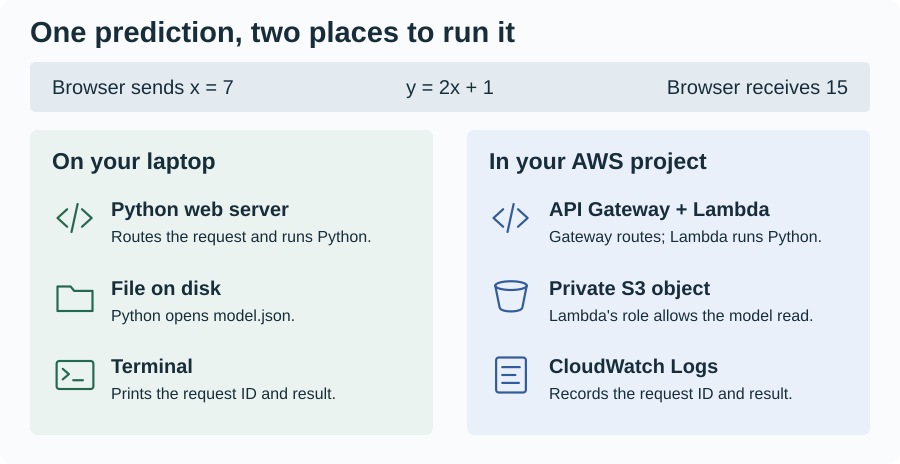
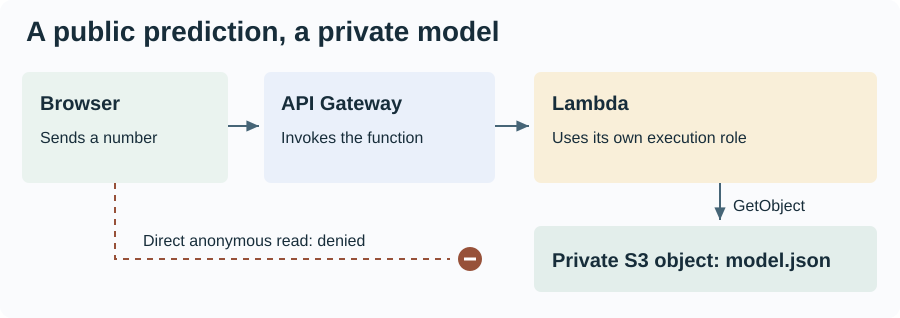
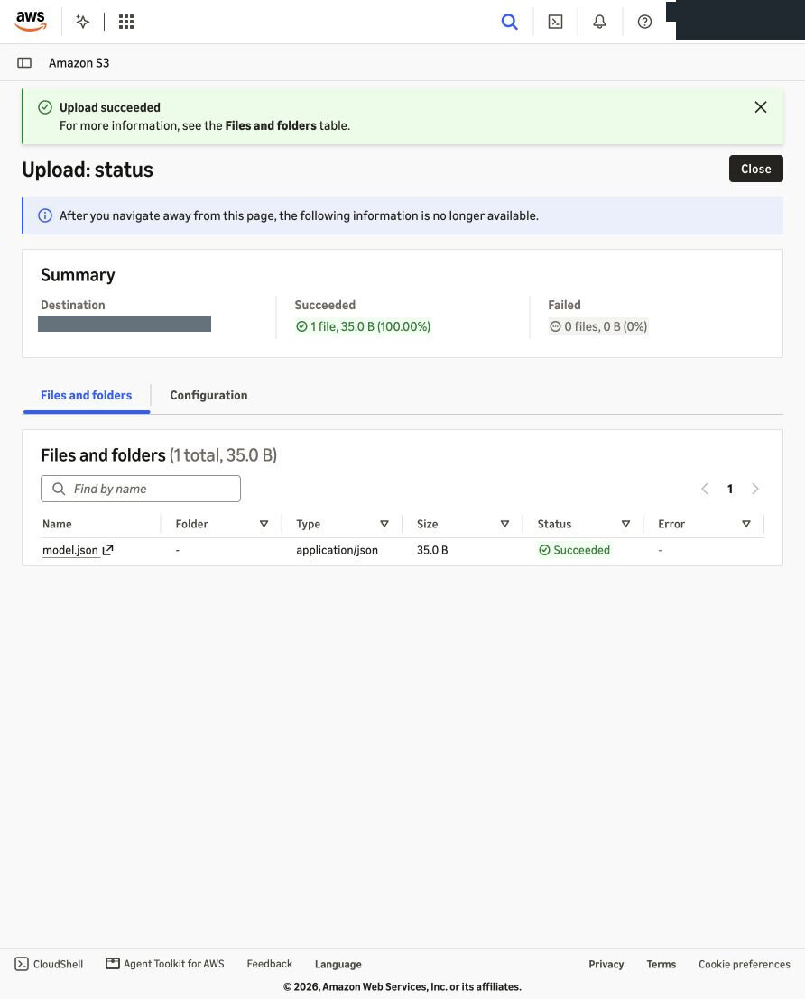
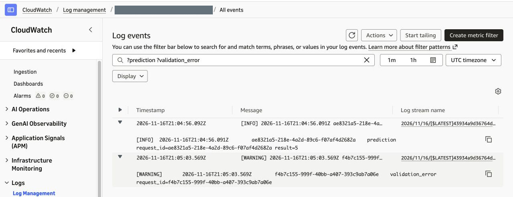
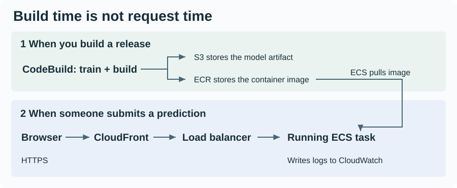
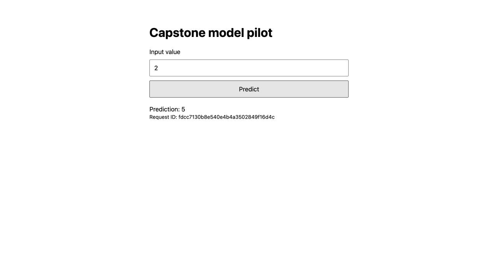
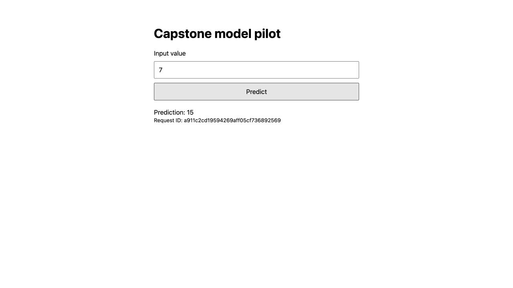

# 00 - AWS at a Glance

On your laptop, a Python function can open `model.json`, calculate a prediction
and print the result in your terminal. AWS lets you run the same idea without
leaving your laptop switched on. The difference is that you choose **where the
file lives, what runs the code, and who is allowed to read it**.

## Follow One Prediction

Suppose you enter **7** in a web form. The diagram compares the same request
locally and in the optional web walkthrough. Only the backend reads the model; neither
the model nor AWS credentials are sent to the browser.

The function reads the model, calculates `2 × 7 + 1`, and returns **15**.
S3 stores the file but does not run Python. API Gateway routes the request but
does not calculate the answer. An **IAM role** lets Lambda read the one object
it needs. In lessons 02–04 you test from the console; only lesson 05 adds a
public HTTPS address. Keep the resources in one **Region** (a geographic area where
AWS operates) so the resources are easy to find and delete.

**What does that look like in AWS?** In the first capture, find the object
named `model.json`: this is the file the function will read, not a running
model server.

In the second capture, find the application's log message among Lambda's own
execution records. This is where you look when the browser result surprises you.

## Translate the Job, Not the Brand

These are **analogies**, not drop-in replacements. Start with the first five
rows for the walkthrough. The rest are options for a capstone, not a shopping list.

| I need to… | On my laptop | AWS | Azure | Google Cloud |
| --- | --- | --- | --- | --- |
| Store a model by name | File in a folder | S3 | Blob Storage | Cloud Storage |
| Run code for one event | Call a Python function | Lambda | Azure Functions | Cloud Run functions |
| Expose routes over HTTPS | Web server on localhost | API Gateway | API Management | API Gateway |
| Give code limited access | Process user and file permissions | IAM role and policy | Managed identity and Azure RBAC | Service account and IAM |
| Find one request in the logs | Terminal or log file | CloudWatch Logs | Azure Monitor Logs | Cloud Logging |
| Build, test or train briefly on CPU | Run a script and exit | CodeBuild | Azure Pipelines | Cloud Build |
| Store a container image | Local Docker image store | ECR | Container Registry | Artifact Registry |
| Run a containerized web service | Run a Docker container | ECS on Fargate | Container Apps | Cloud Run |
| Manage a whole machine and its disk | Local VM and virtual disk | EC2 and EBS | Azure VMs and Managed Disks | Compute Engine and Persistent Disk |
| Query relational data | Local PostgreSQL | RDS for PostgreSQL | Azure Database for PostgreSQL | Cloud SQL for PostgreSQL |

For example, an object store can hold a whole model file but is not a mounted
disk or a SQL database. A build worker finishes when the script exits; it is
not the place to leave a prediction API running. For more comparisons, see
[Google Cloud's cross-provider service map](https://docs.cloud.google.com/docs/get-started/aws-azure-gcp-service-comparison).

## Example: Serve a Prediction over HTTPS

What changes if your capstone already ships a Docker image? In a separate pilot,
CodeBuild produced the model and image, and ECS ran the UI and API together.
**Read this example only.** The hands-on walkthrough uses Lambda instead and
does not need a distribution, load balancer or running container.

Submitting a second prediction does **not** start a second build: the running
container handles the request using the release already deployed.

See two real responses from the container pilot

**Next:** [01 - Create or Join an AWS Free Project](01-create-an-aws-free-account.md).
