# 01 - Create or Join an AWS Free Project

**Goal:** Open the AWS console for a Free plan project and identify its Region
before creating anything. Allow about 25 minutes; account verification can take
longer. The AWS interface may differ by country or account history.

| Term | Meaning in this course |
| --- | --- |
| AWS Builder ID | Your personal sign-in identity. Having one alone does not give you an AWS project or Free credits. |
| Project and account | In the new AWS experience, a project contains an AWS account that holds and isolates its resources. |
| Region | The geographic location of resources such as your Lambda function or S3 bucket. Use the Region shown for your project. |
| AWS Settings | Where you manage projects and check your plan, credits, and billing. |
| AWS Management Console | Where you open AWS services and create or delete resources in your project. |

## 1. Start the New AWS Sign-Up

1. Open [Sign up for AWS (new)](https://signin.aws.amazon.com/signup?request_type=builderId).
   Check that the site is AWS. Use the newer sign-up page, not **Continue
   with advanced features**.

2. For email signup, enter an address you can access and choose **Continue with
   email**. You can also choose a supported sign-up option shown on the page.
   If you already have a Builder ID, use the matching identity.

   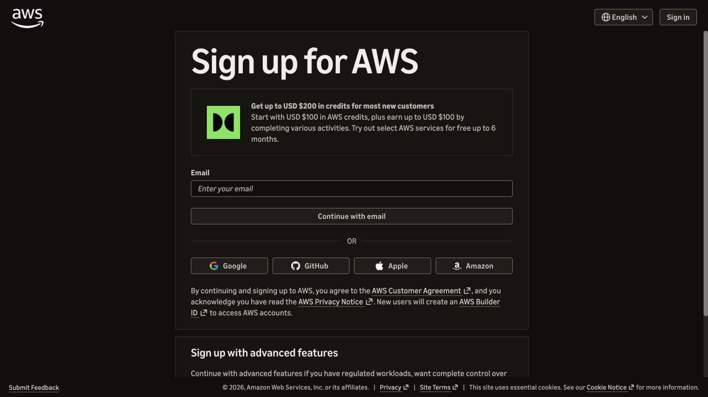

3. Check your inbox, enter the verification code only on AWS, and follow the
   prompts to create or sign in to your Builder ID. Never share the code.

4. Enter your own contact information if asked. Read the terms yourself. If
   asked to select a plan, choose **Free**. If AWS asks for a payment card,
   routes you to **Paid**, or will not verify your account, stop. Do not
   invent account details or change your country to bypass the prompt.

5. AWS can create your first project automatically. Continue to **AWS Settings**
   once account setup is complete or if you are using a project you already own.

The email, contact, and verification screens vary and may expose private
information. The screenshot above shows the entry point, not a guarantee
that every learner will see the same signup flow.

## 2. Secure Your Builder ID

Multi-factor authentication (MFA) adds a second way to verify your identity,
such as a code from an authenticator app or a security key.

1. Open your [AWS Builder ID profile](https://profile.aws.amazon.com/) and sign in.

2. Choose **Security → Register device**. Set a recovery email if AWS asks.

   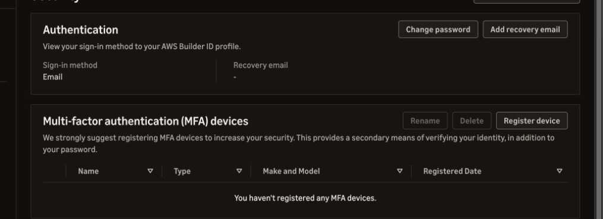

3. For **Authenticator app**, scan the QR code with your app, enter the current
   code, and choose **Assign MFA**. For a security key, choose **Security key**
   and follow the browser prompts. Do not share or screenshot the QR code,
   secret, recovery details, or verification code.

See [AWS's MFA setup instructions](https://docs.aws.amazon.com/signin/latest/userguide/mfa-builder-id.html)
for the device-specific screen. If MFA is already set up, keep it enabled.

## 3. Check the Free Plan and Pick a Project

1. Open [AWS Settings → Billing](https://settings.aws.com/billing). Confirm
   **Current plan: Free**, check **Credits remaining**, and note your plan
   expiry or days remaining. The credit expiry and Free plan expiry can
   differ. Do not click **Upgrade**.

   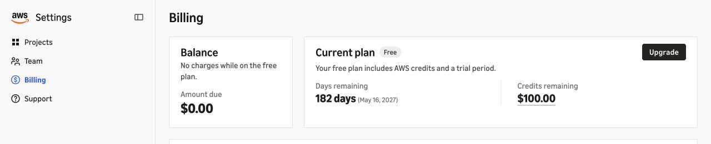

2. Choose **Projects**. Open the project AWS created, or the dedicated training
   project approved by your coach. If you were asked to make a separate training
   project and the option is available, choose **Create project**, use a name
   such as `mle.aws.practice`, and choose **Create**. Otherwise use the existing
   training project; do not activate advanced features.

   

   
Show the Projects list and the Create project dialog

   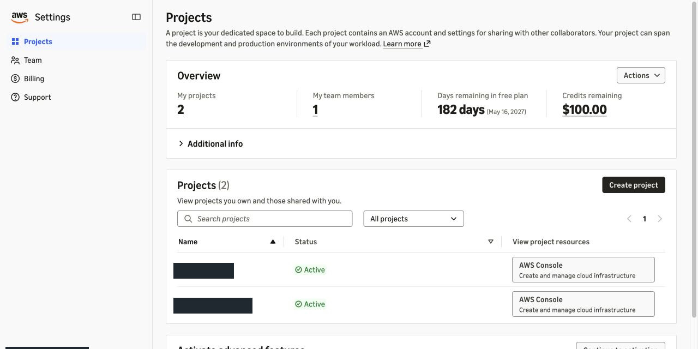

   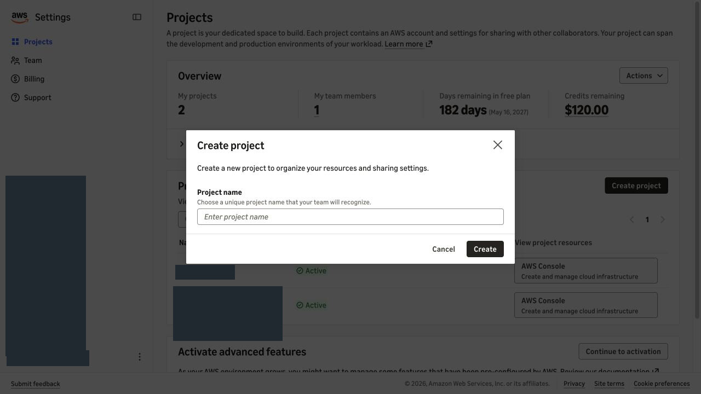

   

3. Open the project details, expand **Additional info**, and record its
   actual **Region**. In the training
   example it is **Europe (Stockholm), eu-north-1**; AWS may assign another
   Region based on your address. If a service page opens in the wrong Region,
   return to the console link for your project and check again.

   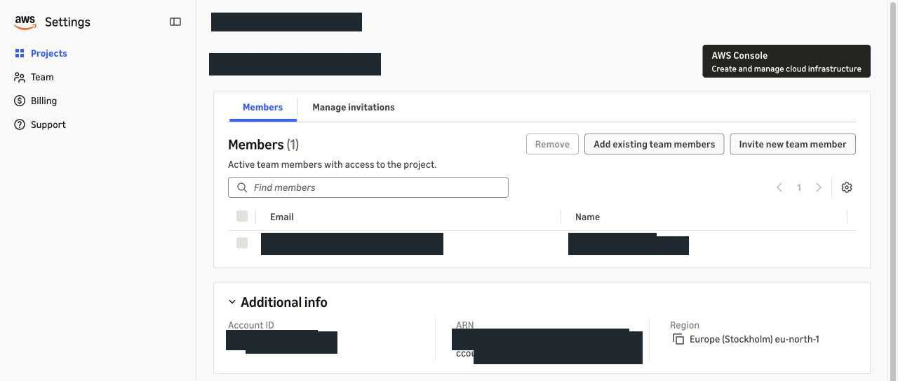

4. Choose **AWS Console**. On Console Home, locate the global service search
   and **Cost and usage**. Do not paste personal information into the AWS
   assistant or use the agent setup prompt.

   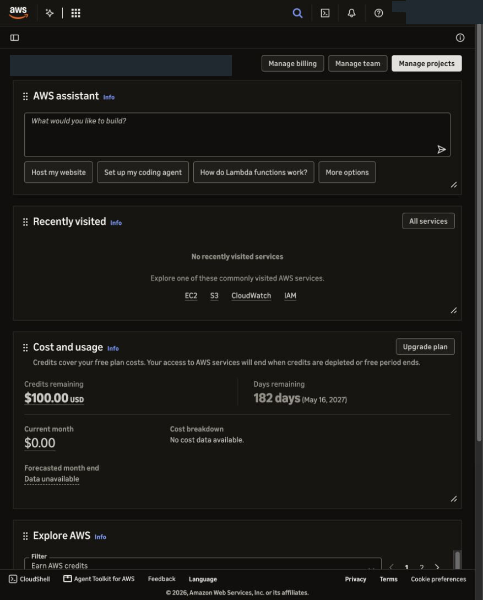

## Optional: Earn Credits and Set a Budget Alert

Eligible new AWS customers get **USD 100 at sign-up** and can earn **up to
USD 100 more**, usually USD 20 per eligible activity. Opening another project
does not give you a new credit balance. Check the activities and deadlines
shown on your own console. Do not switch to Paid or activate advanced
features for an activity. Some activities use credits while their resources run.

**AWS Budgets** can email you when actual or forecast usage reaches a cost
threshold. **An alert is not a spending cap:** it can arrive late and does
not stop or delete resources. This 5–10 minute walkthrough is optional;
skip it if the mission is absent or you do not control the training project.

1. Open **AWS Console Home** for the approved Free project. In **Explore
   AWS**, open **Filter** and choose **Earn AWS credits**. If the filter is
   already selected, open the listed activity directly.

   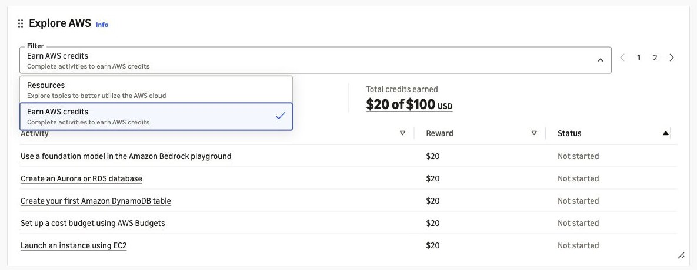

2. Choose **Set up a cost budget using AWS Budgets**. Read its reward and
   **Complete by** date, then choose **Start activity**.

   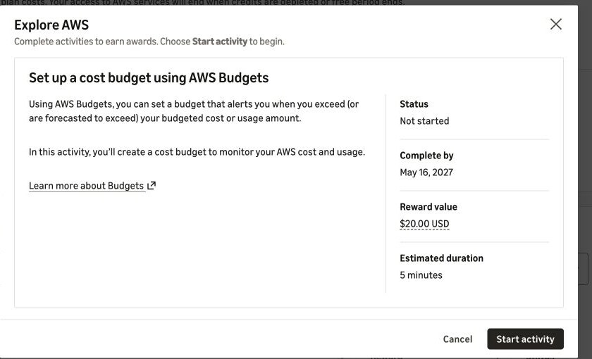

3. Keep **Use a template (simplified)** and **Monthly cost budget**, as
   preselected by the activity. Follow the guided **Next** prompts to name
   it `mle-capstone-alert`, enter **5 USD** as an example alert budget, and
   add an email address you own. The address in the capture is a placeholder.

   

   
Show the budget template, name, amount, and email fields

   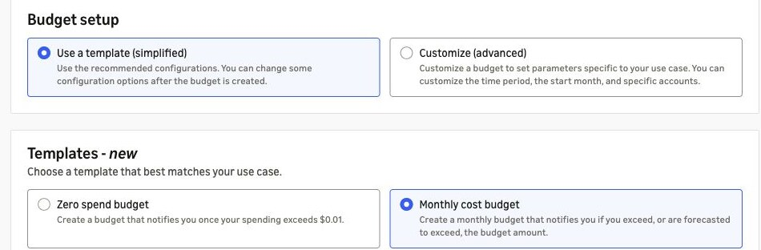

   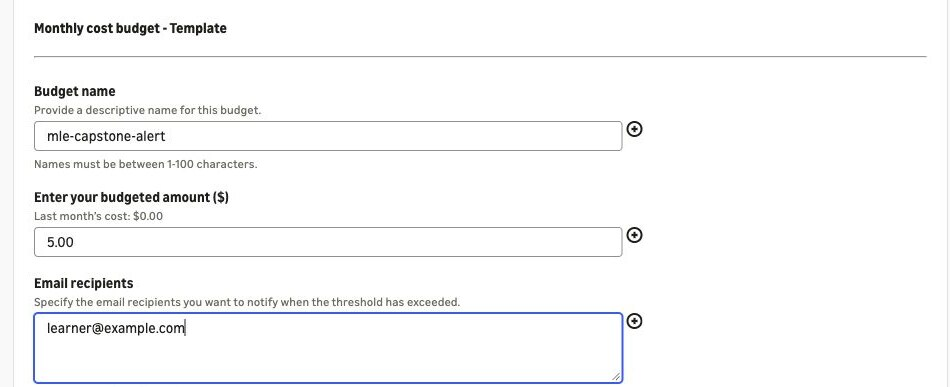

   

4. Review the project, amount, and email. Choose **Create budget** and
   check that it is listed in **Budgets**. Check the activity status on
   **Console Home** and open **AWS Settings → Billing → Credits remaining**
   to confirm any award. AWS says a reward can take up to 30 minutes to
   appear. Keep the alert for your capstone or delete it from **Budgets** if
   you created it only for this walkthrough.

   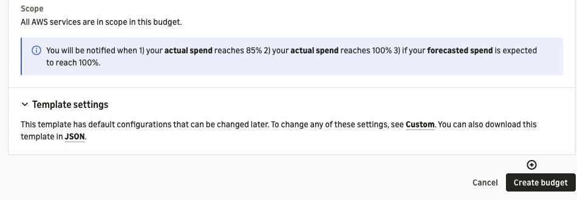

[AWS credit activities and deadlines](https://aws.amazon.com/free/free-tier-faqs/)
· [AWS Budgets for projects](https://docs.aws.amazon.com/cost-management/latest/userguide/bcm-lite-create-a-budget.html)

## If You Cannot Start Without a Card

1. Tell the coach and stop before adding payment details. AWS says most new
   users can start without a card, not that everyone can. A prior AWS account,
   country, or a verification step can change what you are offered.
2. If the coach supplies an isolated Free training project, open the invite
   from the coach, accept it with your own Builder ID, then go to **AWS
   Settings → Projects → AWS Console**. The owner verifies the plan and
   remaining credits. Do not use a shared login or your own production account.
3. If no approved project is available, pair with someone in an approved
   project or follow the captures and predict the results before opening the
   screenshots. There is no need to buy a subscription for this lesson.

The [AWS invitation guide](https://docs.aws.amazon.com/accounts/latest/reference/invite-team-members.html)
explains the permissions and invitation process. Invitations are
managed by the coach, not by learners.

**Checkpoint:** You have a Free project confirmed by you or its owner,
and you know the Region. Continue with [02 - Store a Model in S3](02-store-a-model-in-s3.md).

[AWS sign-up guide](https://docs.aws.amazon.com/accounts/latest/reference/sign-in-new.html)
