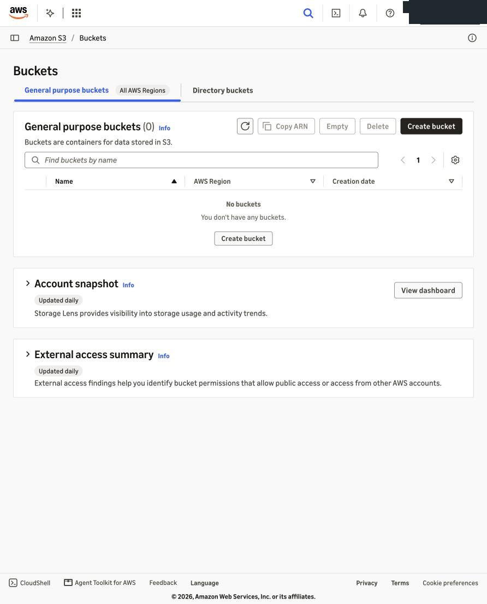
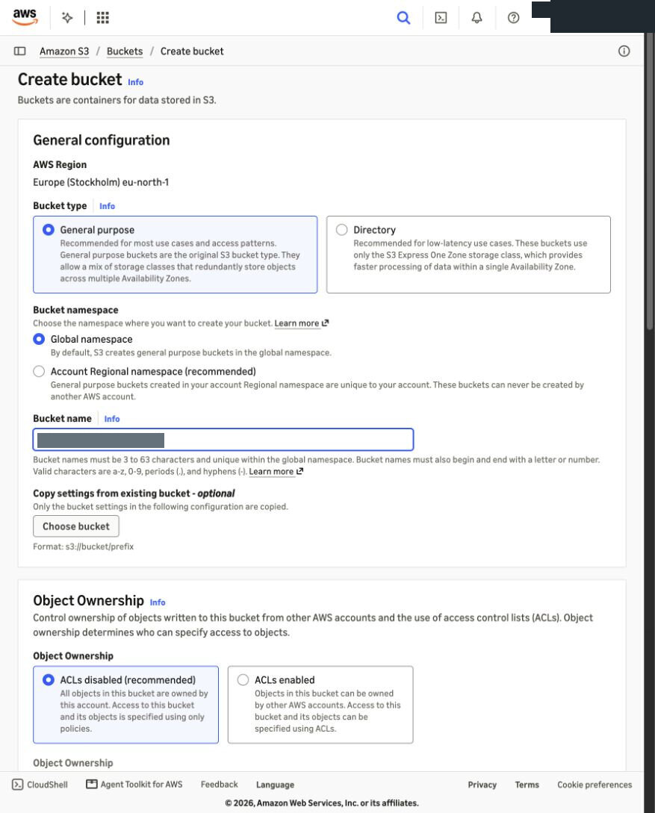
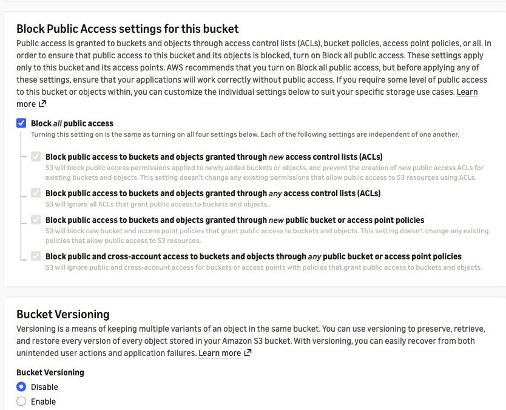
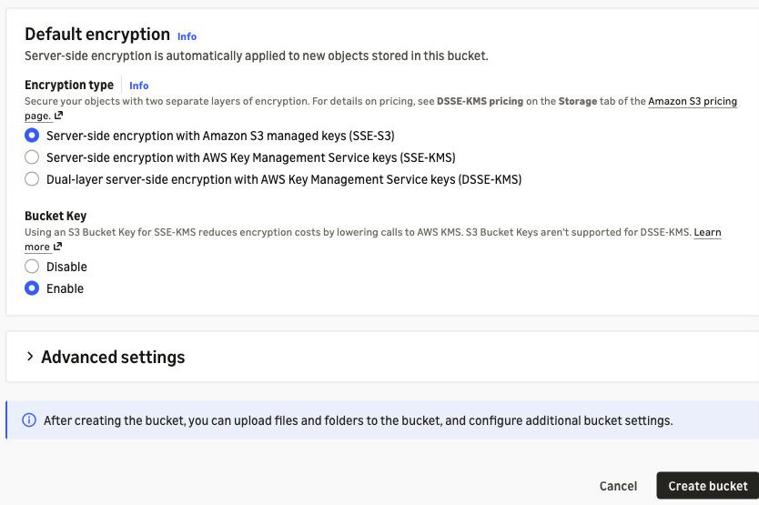
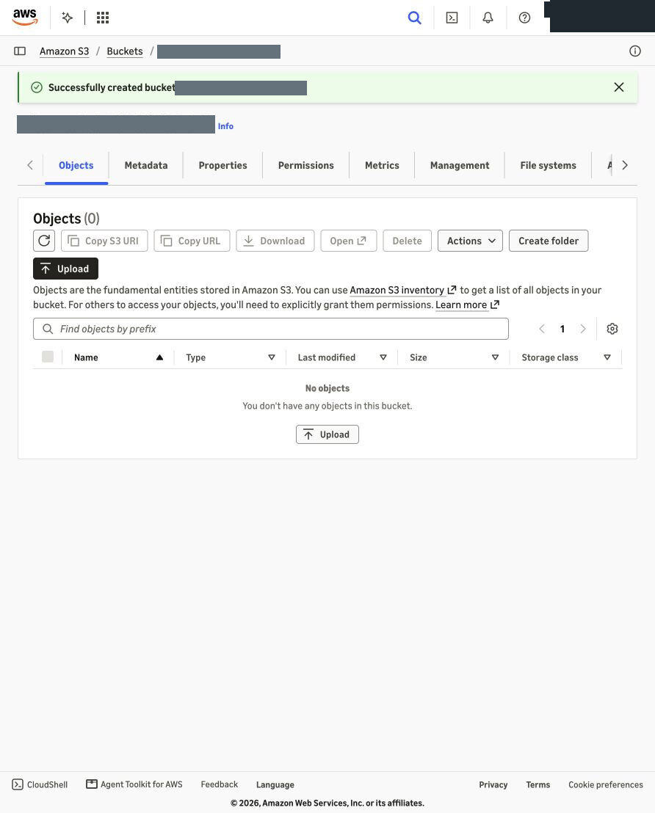
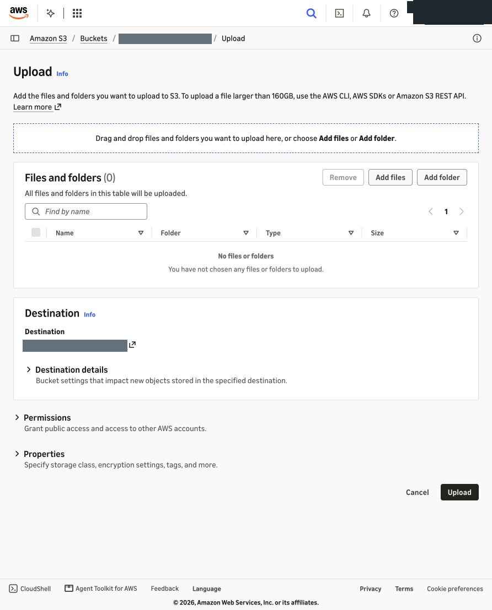
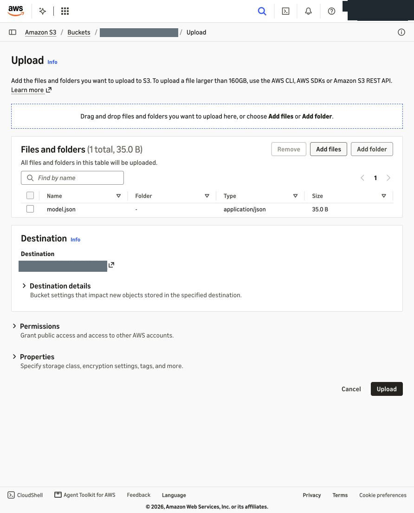
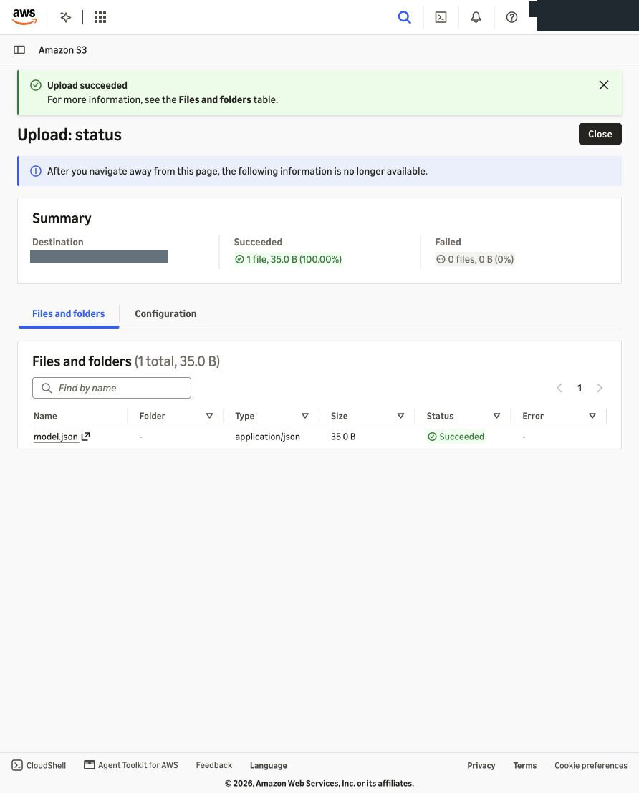
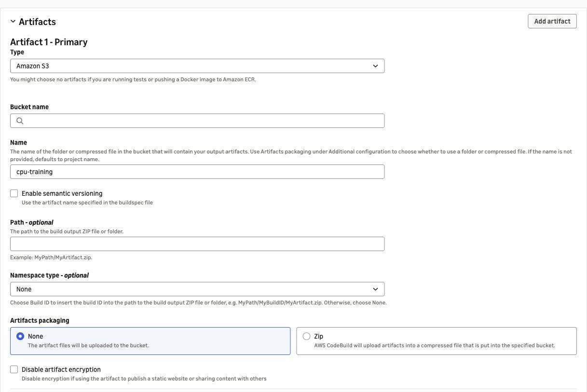
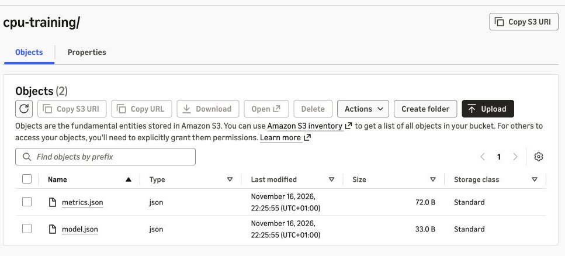

# 02 - Store a Model in S3

**Goal:** Store a model artifact in a private bucket. Amazon S3 is object
storage: a **bucket** holds files as **objects**, each identified by a
**key** (its name or path in the bucket). Here the key is `model.json`, which
holds two numbers for the synthetic model `y = 2x + 1`. S3 stores the
artifact; it does not train the model or run predictions.

## 1. Create a Private Bucket

1. In your project's AWS Console, choose **S3** on Console Home or search
   for **S3**. Open **Buckets → General purpose buckets → Create bucket**.

   

2. Check **AWS Region** against your project's Region. Choose **General
   purpose** and **Global namespace** if the namespace choice appears. In
   **Bucket name**, enter a unique lowercase name such as
   `mleaws-<random-suffix>` (replace the entire placeholder, including
   brackets). Do not use your real name, student ID, or email. If AWS says
   the name is taken, choose another suffix. Record the exact name.

   

3. Keep **ACLs disabled** and **Block all public access** checked. Keep bucket
   versioning disabled for this temporary bucket, and leave default encryption
   at **SSE-S3**. Do not change account-level public access settings.

4. At the bottom, choose **Create bucket**. You should see a success message
   and an empty **Objects** tab, or a list with a link to your bucket.

   

   
Show the private settings and creation result

   

   

   

   

## 2. Upload and Verify the Artifact

1. From your bucket's **Objects** tab, choose **Upload → Add files**.

2. Select [model.json](example/model.json) from your downloads. Confirm its
   name is exactly `model.json`, not `model.json.txt`. Upload to the bucket
   root, not a folder, and do not upload your own data.

   

3. Choose **Upload** at the bottom. Wait for **Upload succeeded**. Choose
   **Close** to return to **Objects**. You should see one object.

   

   
Show the staged upload and success result

   

   

   

4. Select the checkbox for `model.json` and choose **Download** if you want
   to verify its contents. Leave it private. An object URL opened without
   authentication is not a supported access path for this walkthrough.

## Optional Demo: Train on CPU with CodeBuild

**10–15 minutes, instructor-led.** CodeBuild starts a temporary CPU worker,
runs the commands in [buildspec.yml](example/cpu-training/buildspec.yml), and
uploads the output to S3. This demo produces the same model format the
Lambda function reads, but it fits the coefficients from data instead of starting
with the supplied artifact. No endpoint, GPU, or Docker server is needed.

Prepare before the session: console setup

1. Confirm **Free** and use a dedicated private S3 bucket in the project's
   Region. Select [train.py](example/cpu-training/train.py) and
   [buildspec.yml](example/cpu-training/buildspec.yml) in your file manager,
   compress the two files into `cpu-training-source.zip`, and upload it to
   the bucket. Both files must be at the root of the ZIP, not inside a folder.

2. Open **CodeBuild → Build projects → Create project**. Choose **Default
   project** and give it a unique name such as `mle-cpu-demo-<suffix>`.
   Under **Source**, choose **Amazon S3**, select the private bucket, and set
   **S3 object key or S3 folder** to `cpu-training-source.zip`.

3. In **Environment**, select the managed **Amazon Linux** Standard x86-64
   image `aws/codebuild/amazonlinux-x86_64-standard:6.0` and a new service
   role dedicated to this project. Under **Additional configuration**, use
   **2 vCPUs, 4 GiB**, a **10-minute** timeout, and no retries. Keep
   privileged mode and Docker server off; no custom VPC is needed.

4. Choose **Use a buildspec file** and leave the path blank to use the
   root `buildspec.yml`. Under **Artifacts**, choose **Amazon S3**, select
   the same bucket, enter `cpu-training` for **Name**, and leave **Path**
   blank, **Namespace type** and **Artifacts packaging** at **None**. Keep
   encryption and **CloudWatch logs** enabled, then create the project.

   

If the console denies access or requires an upgrade, stop and use the
script and expected results below. Do not broaden permissions or change plans.

1. **Inputs and job (3 min).** Show the source ZIP in S3 and the
   CodeBuild project. Open `train.py`: it fits a linear regression on 80
   synthetic examples and holds out 20 to check it. Choose **Start build**
   once. While it starts, show how the buildspec separates the training
   command from the files CodeBuild uploads.

2. **Run and inspect (5–7 min).** Open **Build history → Build logs**.
   Look for `cpu_training_complete` and a successful artifact upload.
   In the bucket, open `cpu-training/`: `model.json` contains `slope: 2`
   and `intercept: 1`; `metrics.json` reports `mean_absolute_error: 0.0`
   on the 20 held-out examples. The zero error is expected for these
   noise-free synthetic data, not a claim about real-data performance.
   The prediction function still uses its own copy of `model.json`.

   

3. **Clean up (2–5 min).** Stop any unfinished build and wait for it to
   stop. In **Build history**, select only this run and choose **Delete
   builds**, then delete its CodeBuild project. Delete its
   `/aws/codebuild/<project-name>` log group and dedicated IAM role. In
   **IAM → Policies**, remove only the unattached policies created for
   this project (`CodeBuildBasePolicy-…` and `CodeBuildS3ReadOnlyPolicy-…`).
   Empty and delete the demo bucket, then verify removal. Do not delete a
   learner's bucket. If the demo runs long, show the expected results and
   finish cleanup without extending the session.

**Checkpoint:** You know your bucket name and the object key is
`model.json`. Next: [03 - Deploy a Prediction Function](03-run-a-prediction-with-lambda.md).
