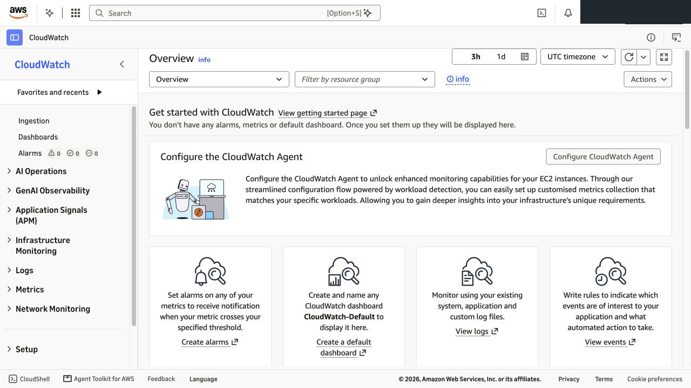
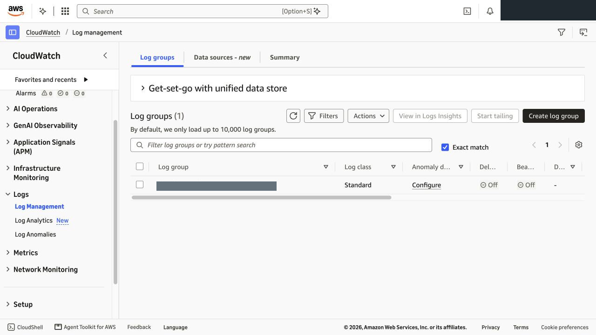
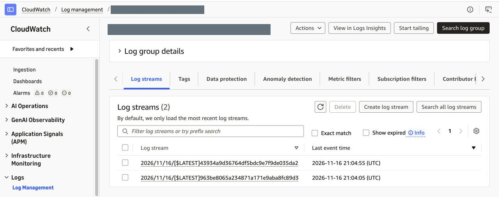
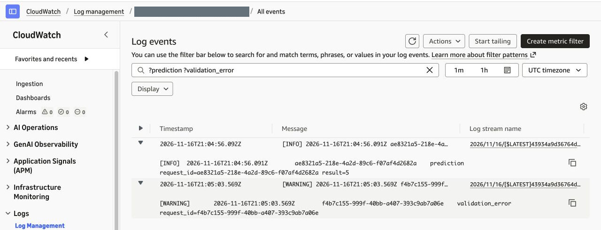

# 04 - Read the Logs in CloudWatch

**Goal:** Connect a result in the Lambda console to the evidence in logs.
CloudWatch Logs collects the messages emitted during a Lambda invocation.
The function has a **log group**, with one or more **log streams** from its
execution environments. Use the **request ID** to match messages to one
specific invocation.

## 1. Find the Function's Log Group

1. In the same project and Region, search for **CloudWatch** under
   **Services**. In the side navigation, choose **Logs → Log Management**
   (some layouts call this **Log groups**) and open the **Log groups** tab.

   

2. In **Filter log groups**, enter the full name
   `/aws/lambda/<your-function-name>` when **Exact match** is checked.
   Open the matching group. Lambda creates it on the
   first invocation if its role can write logs. If the list is empty, check
   the Region, refresh after a short delay, and verify the logging policy.

   

3. Collapse **Log group details** or scroll down to the **Log streams**
   table. Select the most recent stream by clicking its name. If the request
   is not there, choose **Search all log streams** and filter by the request
   ID you recorded in the Lambda result.

   

## 2. Explain What Happened

1. Locate the `prediction` event with your request ID. Select the chevron on
   the left of the row to read the full message. Confirm `result=5` or
   `result=15`.

2. Find and expand the `validation_error` event from the invalid input. A
   validation warning is different from an exception such as S3 `AccessDenied`.

3. Find the corresponding `REPORT` line. Compare **Duration** (execution
   time reported by Lambda) and **Billed Duration** (the duration used for
   billing). Neither is the end-to-end time experienced by a client. A
   colder first invocation may show **Init Duration** as well.

   The capture below uses `?prediction ?validation_error` to show either
   application message. Clear the filter to see the Lambda `REPORT` lines.

   

Do not add a paid dashboard or log analytics feature for this exercise. Log
storage can continue to use credits after the function stops receiving
requests. Delete the function's log group during cleanup.

## Exercise: Change the Model, Not the Code

Find a way to make the same Lambda return `7` for `{"x": 2}` without
editing or redeploying Python, creating a new role, or exposing the bucket.
Verify the new result in CloudWatch. Keep the original model file intact
locally, and restore it in S3 or proceed to cleanup when done.

Show reference solution

Make a temporary copy of the model file named `model.json`. Change the
intercept to `3` and keep the slope at `2`. Upload it to the **same bucket
and key**. Retest `{"x": 2}`: the function reads the object and returns
`2 * 2 + 3 = 7`. Match the request ID to the new log. Restore the original
file if you plan to run the baseline again.

## Check Your Understanding

1. Why does a private S3 bucket still work with Lambda?
2. Why can an invocation succeed when its application result says
   `"ok": false`?
3. Which two AWS resources remain if you delete only the function, apart
   from its IAM role?

Show answers

1. Lambda assumes a role granted `s3:GetObject` for that object. No public
   access is needed.
2. Lambda ran the handler successfully. The handler returned a controlled
   rejection of invalid input.
3. The S3 bucket (and the object it stores) and the CloudWatch log group
   remain until you delete them separately.

Next: [05 - Serve a Prediction in the Browser](05-serve-a-prediction-in-the-browser.md), or skip directly to
[06 - Clean Up and Check Billing](06-clean-up-and-check-billing.md).
