# 05 - Serve a Prediction in the Browser

**Goal:** Submit a number in a web page, see a prediction from your private S3 model,
and find that exact request in CloudWatch. Complete lessons 02–04 first. If you
already cleaned up, recreate those resources before starting. No CLI is needed.

**What changes?** Previously, only your Lambda console test invoked the function.
API Gateway now gives the browser an HTTPS address. A *route* is a method and
path: `GET /` returns HTML; the form sends `POST /predict` with JSON. Both routes
invoke the same Lambda. Only Lambda reads S3; the browser needs no AWS credentials.
There is no CloudFront distribution, separate frontend server or public bucket.

> [!WARNING]
> This exercise creates a public endpoint without authentication. Use only the
> synthetic model, do not share the URL, stay on the Free plan, and delete the
> API immediately after testing. Requests can consume credits.

## 1. Add the Web Handler to Your Existing Lambda

1. In Lambda, select your function and open **Code → Code source**.
   Keep `lambda_function.py`: it already validates the input and reads the model.
2. In the editor's file explorer, choose **New File**, beside (not inside a folder
   under) `lambda_function.py`. Name it `http_app.py`. Paste [the web handler](example/http_app.py)
   and choose **Deploy**. Wait for the success message.
3. Under **Code → Runtime settings → Edit**, replace **Handler** with
   `http_app.lambda_handler` and choose **Save**. The first part names the module;
   the second names the entry point. Keep the role and `MODEL_BUCKET` unchanged.
4. Restore the original `model.json` if you changed it in lesson 04. In
   **Test**, rerun the saved event with `{"x": 2}`. You should get 5:
   the new handler delegates ordinary console tests to the old one.

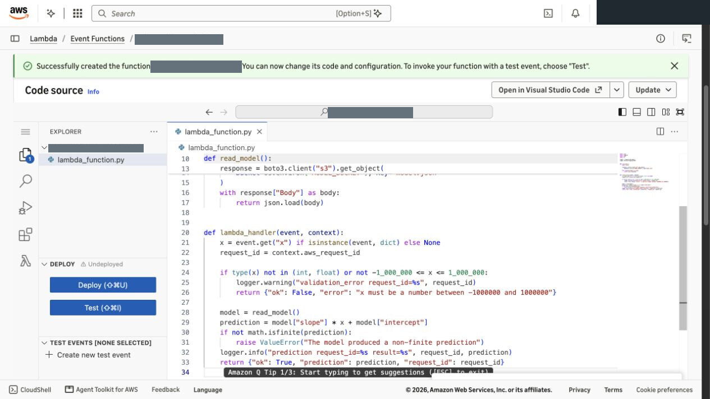

## 2. Connect Two Routes to the Function

1. Search for **API Gateway** in the AWS console. Choose **Create HTTP API**
   on the welcome page, or **Create API → HTTP API → Build** from the API list.

   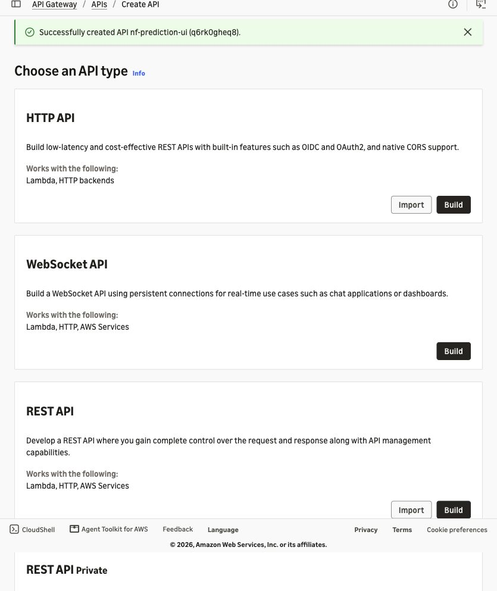

2. Enter **API name** `nf-prediction-ui` (add your initials in a shared
   project). Choose **Add integration → Lambda**. Select your Region and your
   function. Keep payload **Version 2.0** and choose **Next**. If the function
   name does not resolve, copy its **Function ARN** from the Lambda overview
   into this field. Use *your* function, not the pilot name in the screenshots.

   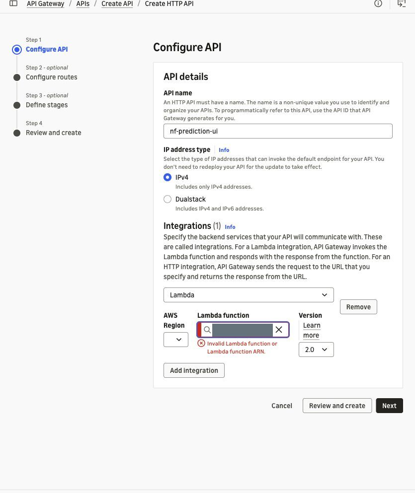

3. Under **Configure routes**, choose **Add route**. Set **Method** to **GET**,
   **Resource path** to `/`, and **Integration target** to your function.
   Choose **Add route** again and set **POST**, `/predict`, and the same target.
   If AWS supplied a suggested route, edit or remove it so only these two
   remain. Choose **Next**.

   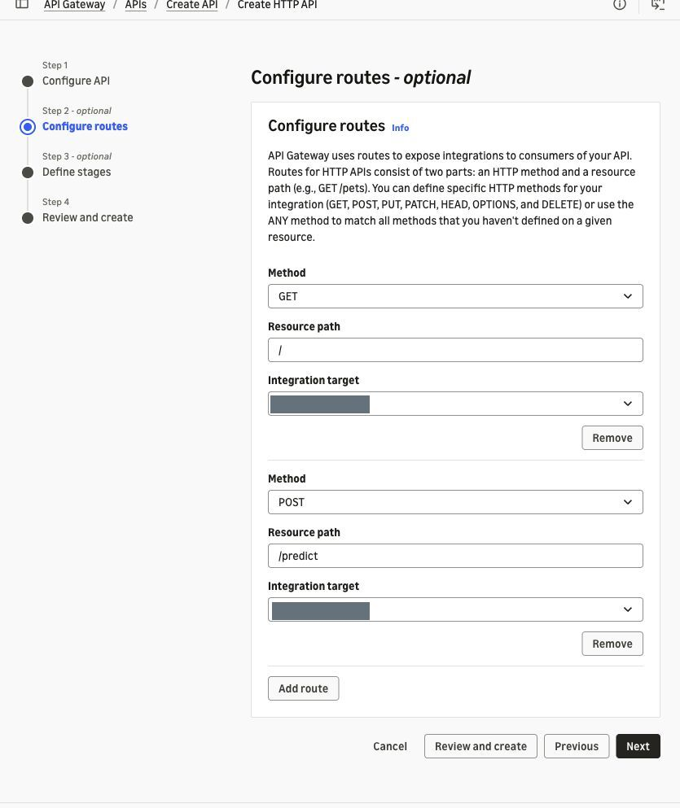

4. Keep the **$default** stage with **Auto-deploy** enabled. A stage is a
   published version of the API configuration. This stage serves the root URL,
   so the form can call `/predict` on the same origin without CORS. Choose **Next**.

   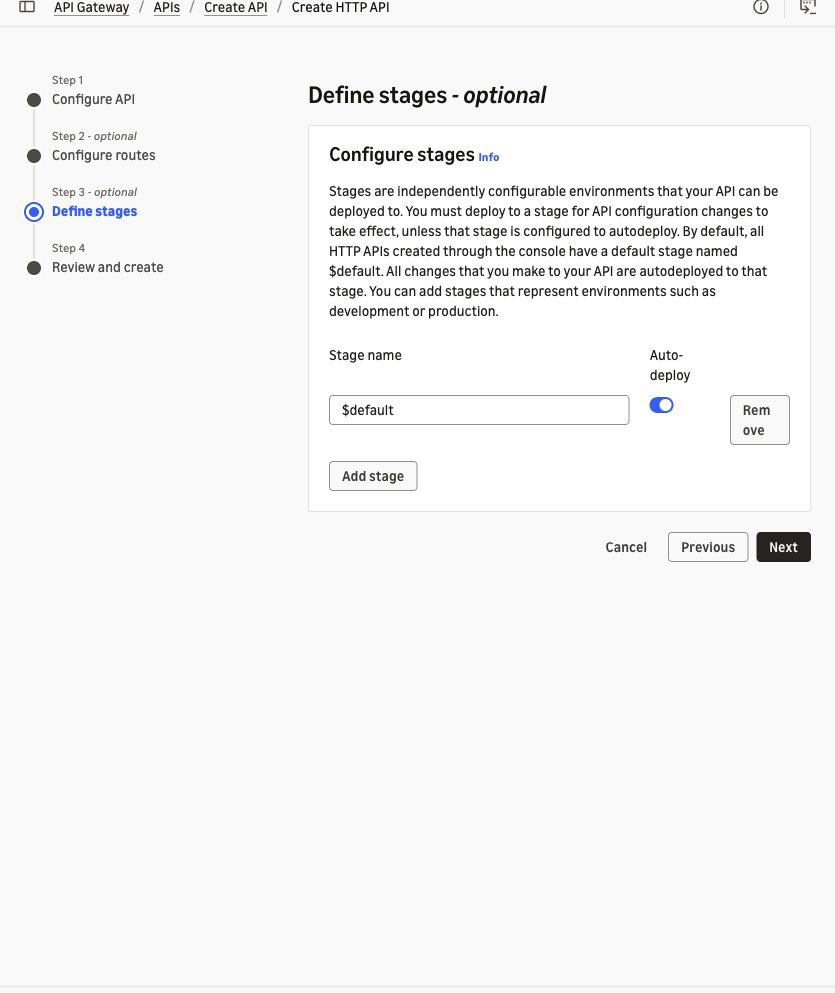

5. Review the two routes and the Lambda target, then choose **Create**.
   API Gateway needs permission to invoke Lambda. This is separate from
   Lambda's permission to read S3; do not broaden the execution role.

   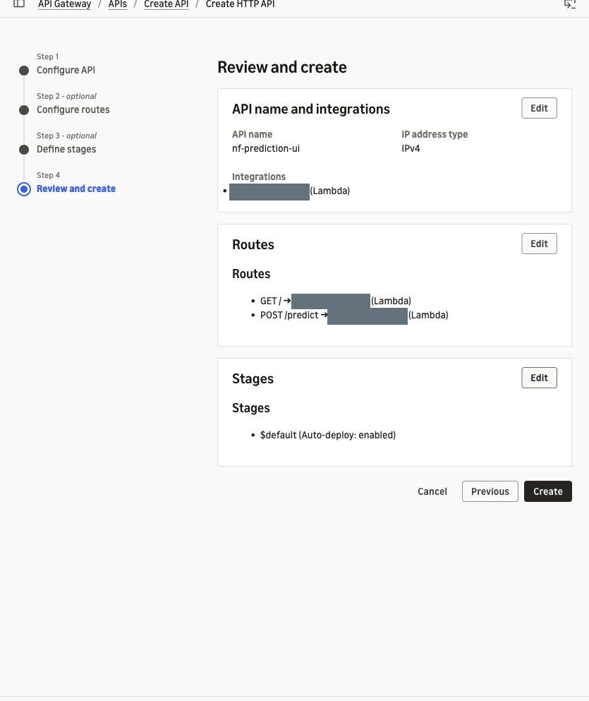

## 3. Make and Trace Two Predictions

1. In the API sidebar, open **Stages → $default**. Under **Stage details**,
   open the **Invoke URL** in a new tab. No path suffix is needed.

   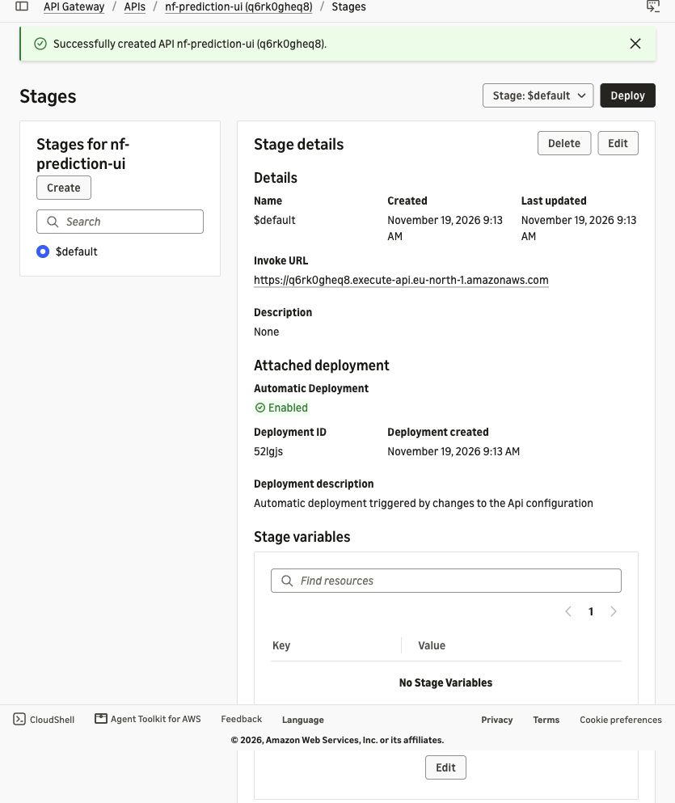

2. Enter **2 → Predict**, then **7 → Predict**. The expected results for the
   supplied model are **5** and **15**. Each submission displays a different
   Lambda request ID. Copy the second one.

   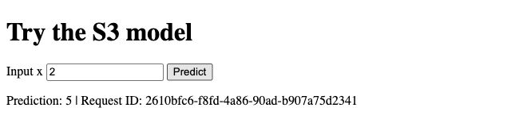

   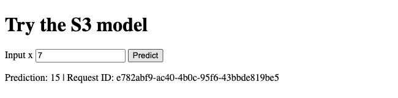

3. Open **CloudWatch → Log groups → /aws/lambda/YOUR-FUNCTION → Search all log streams**.
   Search for your request ID in double quotes; allow a moment for delivery.
   Find the line containing `prediction request_id=...` and `result=15`.
   [Lesson 04](04-read-logs-in-cloudwatch.md) shows the log viewer.

| Symptom | Check |
| --- | --- |
| The browser displays JSON instead of a form | Confirm the handler setting and that the web handler was deployed. |
| The page or form returns Not Found | Check the method, exact path, integration target and auto-deploy. Opening `/predict` in the address bar sends GET, not POST. |
| Internal Server Error | Test the original event in Lambda. Check its log for an import or S3 error; if no invocation appears, check the API integration and Lambda invocation permission. Do not make the bucket public. |

## 4. Remove the Public Endpoint

1. Return to **API Gateway → APIs**. Select the radio button beside **your API**.
   Choose **Delete**, check the name, enter `confirm`, then choose **Delete**.

   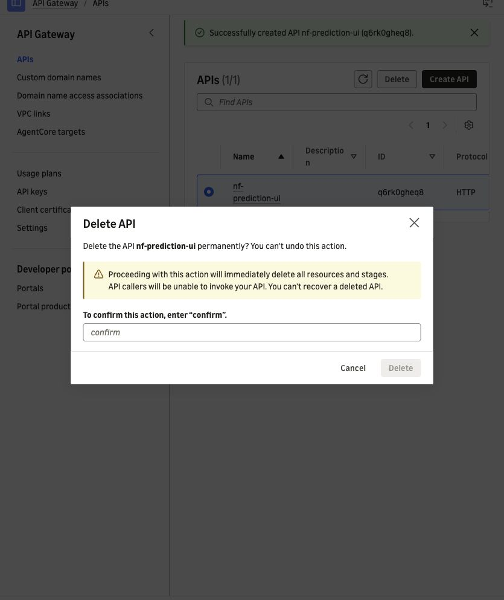

2. Refresh the list. Verify your API is absent; other teams' APIs should stay.
   Continue with [lesson 06](06-clean-up-and-check-billing.md) to remove the
   function, log group, execution role, model and bucket. Deleting an API
   does not delete its backend.

   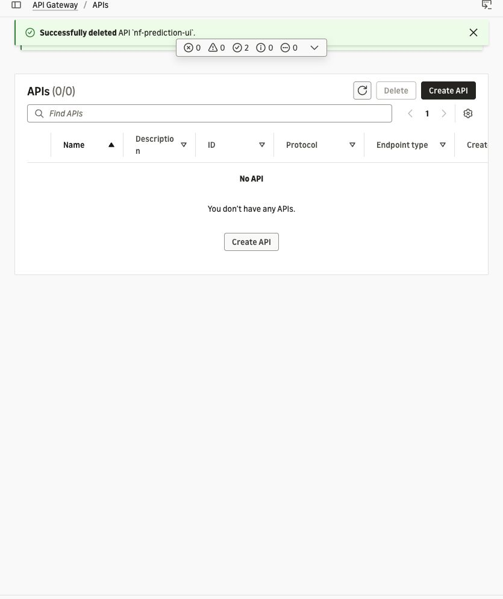

**Bonus: when would DynamoDB help?** This application does not need a database:
each prediction is returned once. Suppose users needed to retrieve a previous
prediction by ID. You could store `request_id` as a DynamoDB partition key
with the input and result as attributes, then add a lookup route. S3 would
still hold the model; CloudWatch would still hold diagnostic logs. Think about
who should be allowed to read a saved prediction. **Do not create a table.**
