# 06 - Clean Up and Check Billing

> [!CAUTION]
> **DELETE THE RESOURCES YOU CREATED. DO NOT JUST STOP, PAUSE, OR CLOSE THE TAB.**
> Storage, IP allocations, log retention, and load balancers can continue to
> consume credits after compute stops. Save any results you need, then
> delete only the resources you created for this lesson. Do this even if
> an earlier step failed.

**Goal:** Delete your resources and verify that none remain.
Check that you are in your training project. Lambda and CloudWatch must match the
chosen Region. The S3 list can show buckets from all Regions; use the one in the
chosen Region. IAM is shown as global. Use your own resource names, not the
example names in the images.

## 1. Delete the Function

If you completed [the UI and API extension](05-serve-a-prediction-in-the-browser.md),
delete its HTTP API first and refresh the API list to verify removal. Deleting
the Lambda function alone does not remove the public API Gateway endpoint.

1. Open **Lambda → Event Functions → your prediction function**.

2. In the top-right **Actions** menu, choose **Delete function**. Verify
   the function name, type `confirm`, and choose **Delete**.

3. Return to **Event Functions**. Refresh or search by name; the function
   must no longer be listed.

   

   
Show the Actions menu, confirmation, and successful deletion

   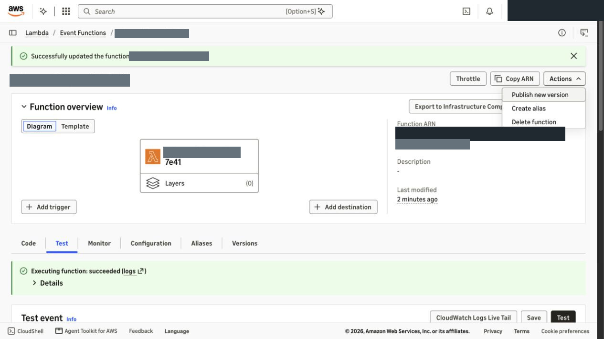

   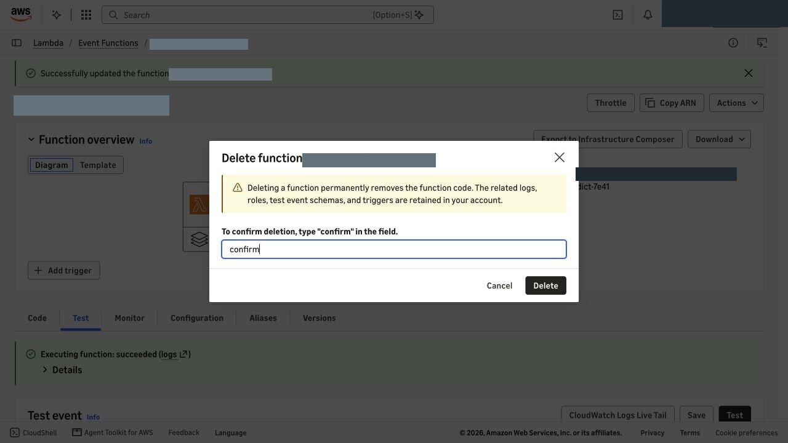

   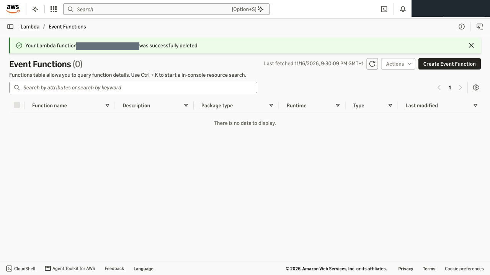

   

## 2. Delete the CloudWatch Log Group

1. Open **CloudWatch → Logs → Log Management → Log groups**. Filter by
   the exact group name, including the `/aws/lambda/` prefix.

2. Select only `/aws/lambda/<your-function-name>`. Choose **Actions →
   Delete log group(s)**. Confirm that the dialog lists only your group,
   then choose **Delete**.

3. Refresh and check that the function's log group is gone. If you
   never invoked the function, the group might never have been created.

   

   
Show the log group deletion steps and success message

   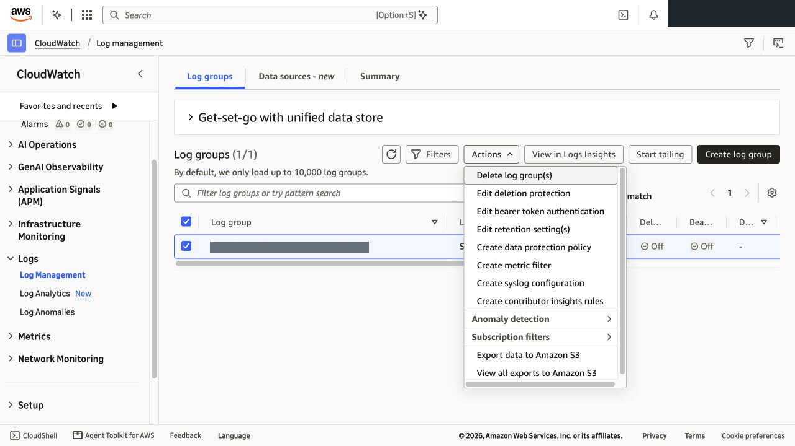

   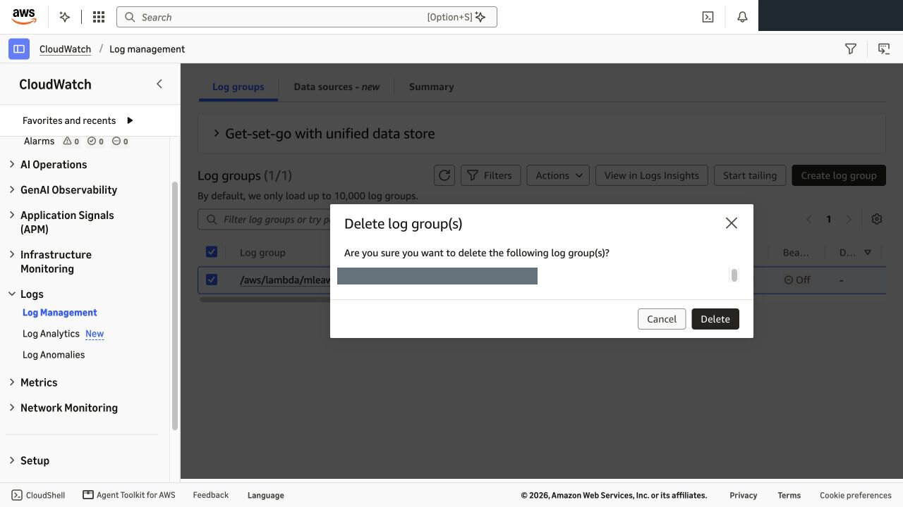

   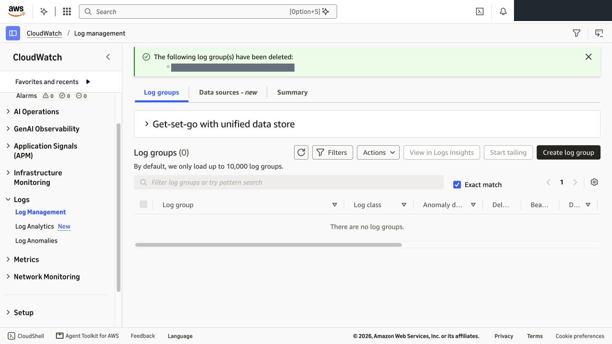

   

## 3. Delete the Dedicated IAM Role

1. Open **IAM → Roles** and search for the exact role you created.

2. Open its details. Confirm that the name ends in the function's `-role`
   and that it is not a shared role such as `PowerUserRole`.

3. Choose **Delete**, type the exact role name, then choose **Delete** again.
   The inline `ReadPredictionModel` policy is deleted with this role. Leave the
   AWS-managed `AWSLambdaBasicExecutionRole` policy alone.

4. Search the Roles list again. The execution role should not appear.

   

   
Show the dedicated role, confirmation, and successful deletion

   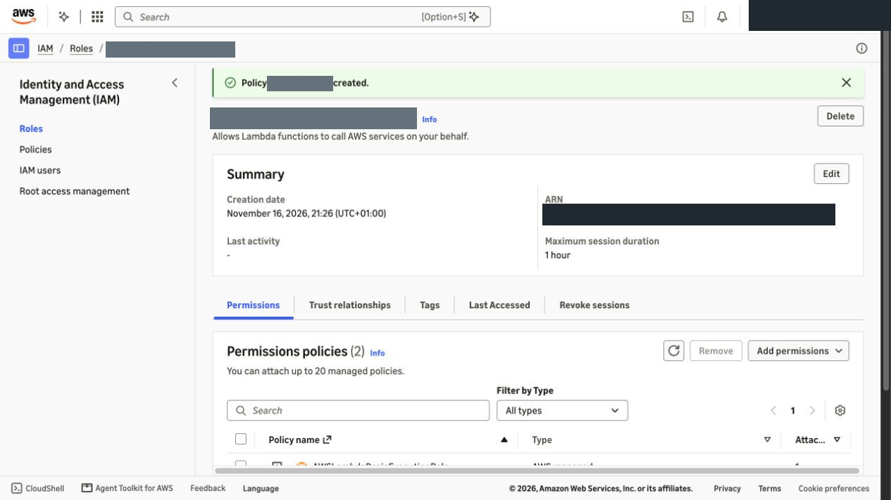

   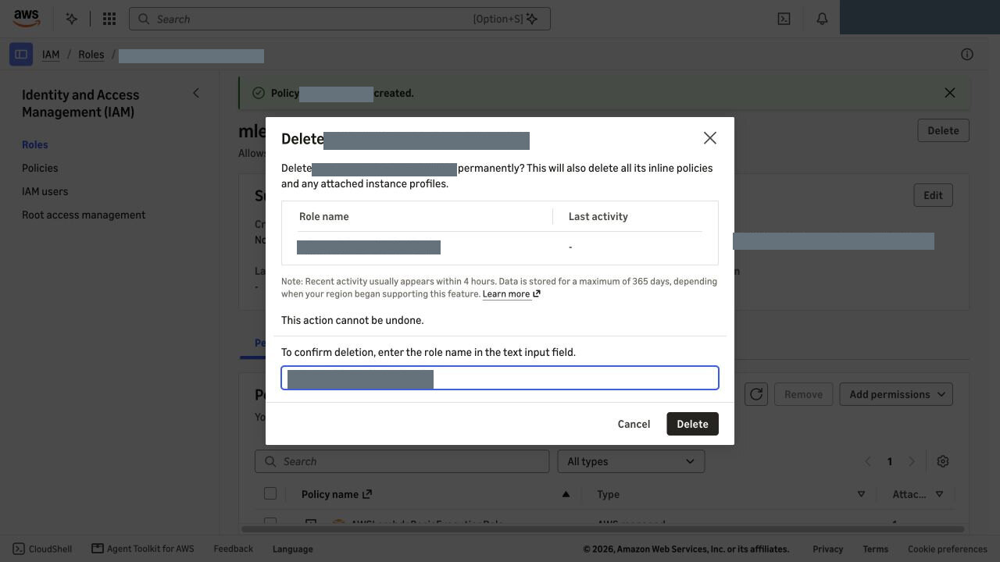

   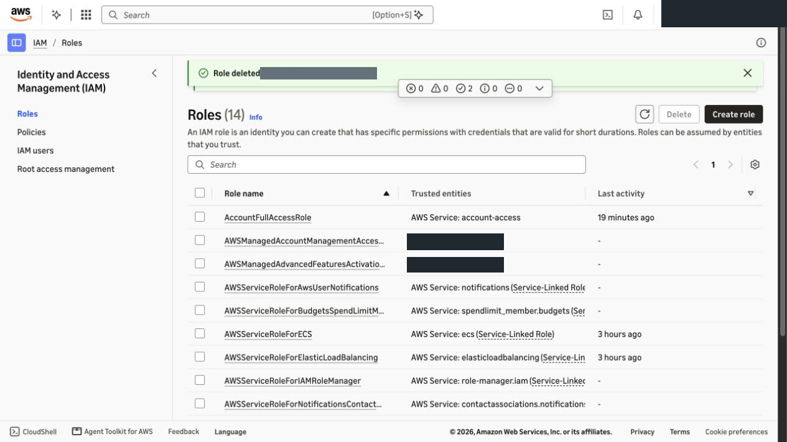

   

## 4. Empty and Delete the S3 Bucket

1. Open **S3 → Buckets → your training bucket → Objects**. Download anything
   you need to keep. Select `model.json` and choose **Delete**.

2. Verify the selected object, type `permanently delete`, then choose
   **Delete objects**. Wait for success and choose **Close**. If you
   intentionally uploaded other exercise files, remove them too. If you
   enabled versioning, you must remove the object versions and delete
   markers as well. Do not empty a bucket shared with another team.

3. Return to **Buckets**. Select the radio button next to **your training bucket**,
   then choose **Delete**. Type its exact name and choose **Delete bucket**.

4. Refresh the bucket list. Check that the object and bucket are both gone.

   

   
Show object deletion, bucket deletion, and the final list

   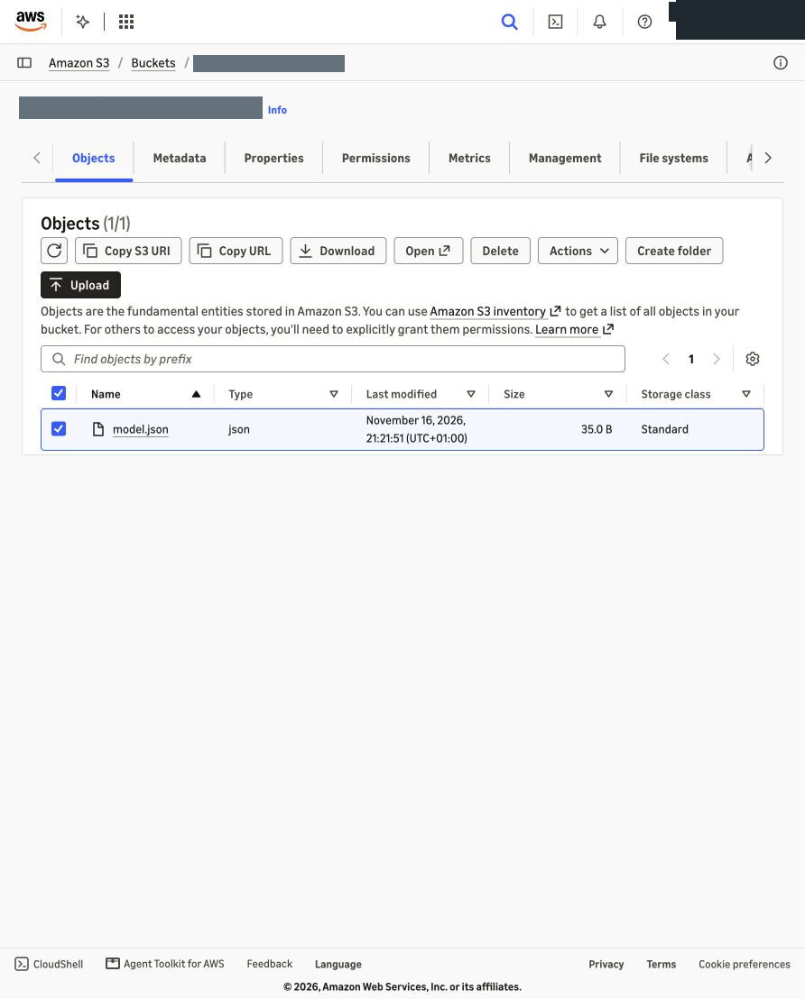

   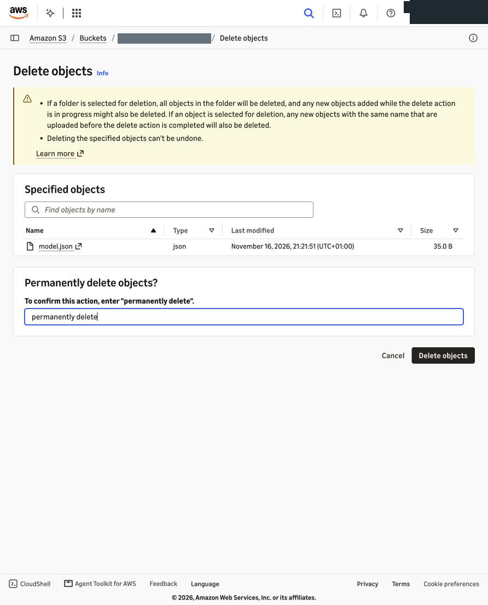

   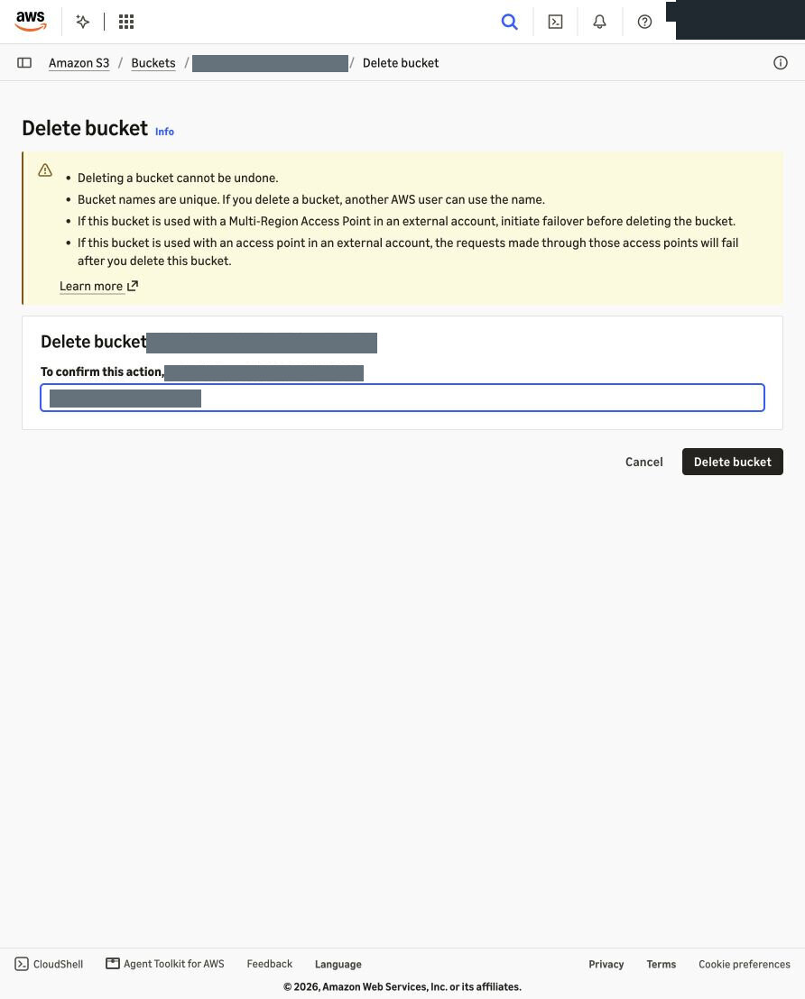

   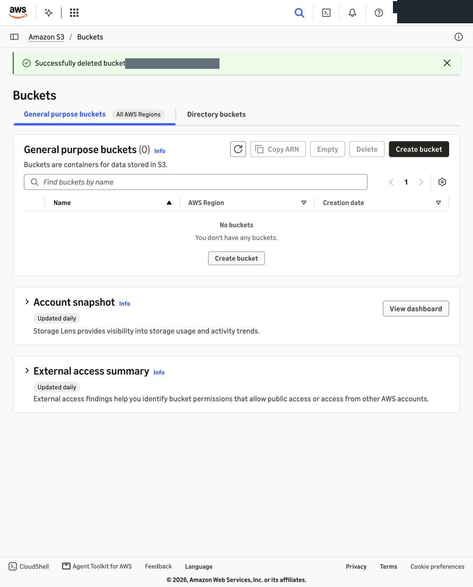

   

## 5. Verify Cleanup and Check the Plan

- [ ] API Gateway (lesson 05 only): your HTTP API is absent.
- [ ] Lambda: your function is absent.
- [ ] CloudWatch: the function's log group is absent.
- [ ] IAM: the dedicated role is absent.
- [ ] S3: the training bucket is absent.

In [AWS Settings → Billing](https://settings.aws.com/billing), confirm
**Free** and check the remaining credits when you have billing access.
If you joined an invited project, the owner checks billing. Billing can be
delayed: use the service lists above as evidence of cleanup. A budget alert
does not delete resources for you.

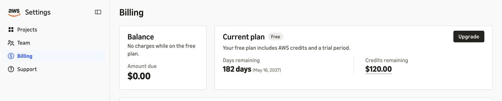

## If You Also Created a Container Stack

The [container example in the introduction](00-aws-at-a-glance.md#example-serve-a-prediction-over-https)
does not require you to deploy anything. If you deploy a similar stack in
your capstone, **stopping an ECS task does not remove its load balancer,
public IP allocations, images, or logs**.

CloudFormation manages a group of related resources as a **stack**. If you
used it, open **CloudFormation → Stacks** and delete your application stack
before the build stack it depends on. Verify that CloudFront, the load
balancer, ECS tasks and services, CodeBuild, and any
project-specific S3 objects, ECR images, log groups, and public IP allocations are
gone. A deleted stack can leave behind resources configured for retention.

If you also used EC2, terminate the training instance and check for leftover
**EBS volumes, snapshots, and Elastic IP allocations**. Do not delete
account defaults, shared resources, or the entire AWS project just to
finish this exercise.

[EC2 instance lifecycle and stopped-resource charges](https://docs.aws.amazon.com/AWSEC2/latest/UserGuide/ec2-instance-lifecycle.html)
