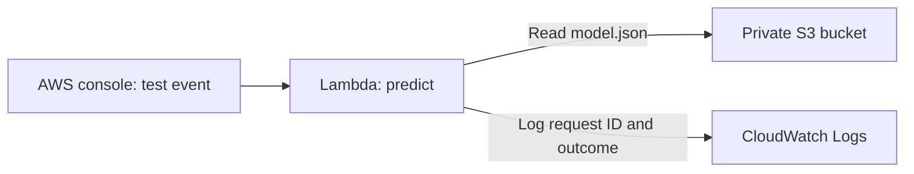

# AWS Fundamentals for Machine Learning

Use the AWS console to store a model artifact, deploy a prediction function,
inspect its logs, and remove every resource you created. The inputs and model
are synthetic. This guided lesson takes about two hours.

You will deploy and test a private Lambda function from the console. The
CloudFront and ECS example shows what a full HTTPS deployment looks like;
you will not create those resources.

Outside the two-hour walkthrough: follow the optional [credits and budget alert](01-create-an-aws-free-account.md#optional-earn-credits-and-set-a-budget-alert)
or watch the [10–15 minute CPU training demo](02-store-a-model-in-s3.md#optional-demo-train-on-cpu-with-codebuild).
For a hands-on HTTPS deployment, [add a web form and prediction API](05-serve-a-prediction-in-the-browser.md)
before you delete your Lambda.

> [!CAUTION]
> **DELETE THE RESOURCES YOU CREATED. DO NOT JUST PAUSE OR STOP THEM.**
> Closing the browser or stopping compute does not remove storage, log groups,
> allocated public IPs, or load balancers. Those resources can keep using your
> Free plan credits, even when no one is running predictions. Follow the
> [cleanup checklist](06-clean-up-and-check-billing.md) before you leave, even
> if the deployment failed partway. Save any files you need first and delete
> **only** the resources you created for this lesson.

> [!WARNING]
> **Stay on the AWS Free plan. Do not add a payment card or choose Paid.**
> If you cannot confirm the Free plan or AWS asks for a card, stop and use the
> [fallback instructions](01-create-an-aws-free-account.md#if-you-cannot-start-without-a-card).
> Free plan activity can consume credits. A billing dashboard that still shows
> a zero balance due does not prove that you removed your resources.

## Learning Objectives

- Distinguish an AWS Builder ID, an AWS project and account, a Region, and a
  service role.
- Store and retrieve a private model artifact in Amazon S3.
- Deploy and invoke an AWS Lambda function with narrowly scoped S3 access.
- Trace a successful prediction and a validation failure in CloudWatch Logs.
- Choose AWS services for a capstone and verify that temporary resources are gone.

## Learning Path

| File / Folder | Description |
| --- | --- |
| [00 - AWS at a Glance](00-aws-at-a-glance.md) | Start here: follow one prediction and compare local, AWS, Azure and Google Cloud services. |
| [01 - Create or Join an AWS Free Project](01-create-an-aws-free-account.md) | Sign in, protect your identity, and verify the plan and Region. |
| [02 - Store a Model in S3](02-store-a-model-in-s3.md) | Create a private bucket and upload the model artifact; optional CPU training demo. |
| [03 - Deploy a Prediction Function](03-run-a-prediction-with-lambda.md) | Give Lambda access to one object and run a prediction in the cloud. |
| [04 - Read the Logs](04-read-logs-in-cloudwatch.md) | Find a request by ID and diagnose a failed prediction. |
| [05 - Serve a Prediction in the Browser](05-serve-a-prediction-in-the-browser.md) (optional) | Connect a web form to a real prediction API, trace its request, then remove the public endpoint. |
| [06 - Clean Up and Check Billing](06-clean-up-and-check-billing.md) | Delete the function, log group, role, and bucket and verify removal. |

### Additional Folders and Files

| File / Folder | Description |
| --- | --- |
| [example/](example/) | Synthetic model, Lambda handler, IAM policy, and optional CPU training files. |
| [assets/screenshots/](assets/screenshots/) | AWS console screenshots arranged by walkthrough. |

## Prerequisites

- A web browser and access to your own email inbox for verification.
- A phone authenticator app, passkey, or security key for AWS Builder ID MFA.
- No AWS CLI, Docker, local Python, GPU, LLM provider, or API key is required.

## Setup

Some screenshots hide resource names. Where a field is masked, use the
name you chose for your own resource, not the text from the screenshot.

1. Open the [account walkthrough](01-create-an-aws-free-account.md). If you
   were invited to a training project, follow the invite path instead of
   setting up a second AWS account.
2. Download [model.json](example/model.json) from its GitHub file view using
   **Download raw file**. Keep its original filename. Keep the handler and IAM
   policy tabs open for copying in the browser.
3. Keep the [cleanup checklist](06-clean-up-and-check-billing.md) open while
   you work. Use one project, one Region, and unique names for your resources.

## References & Further Reading

- [AWS Free Tier FAQ](https://aws.amazon.com/free/free-tier-faqs/)
- [Services supported by the new AWS experience](https://docs.aws.amazon.com/accounts/latest/reference/supported-services-sign-up-new.html)
- [Lambda execution roles](https://docs.aws.amazon.com/lambda/latest/dg/lambda-intro-execution-role.html)
